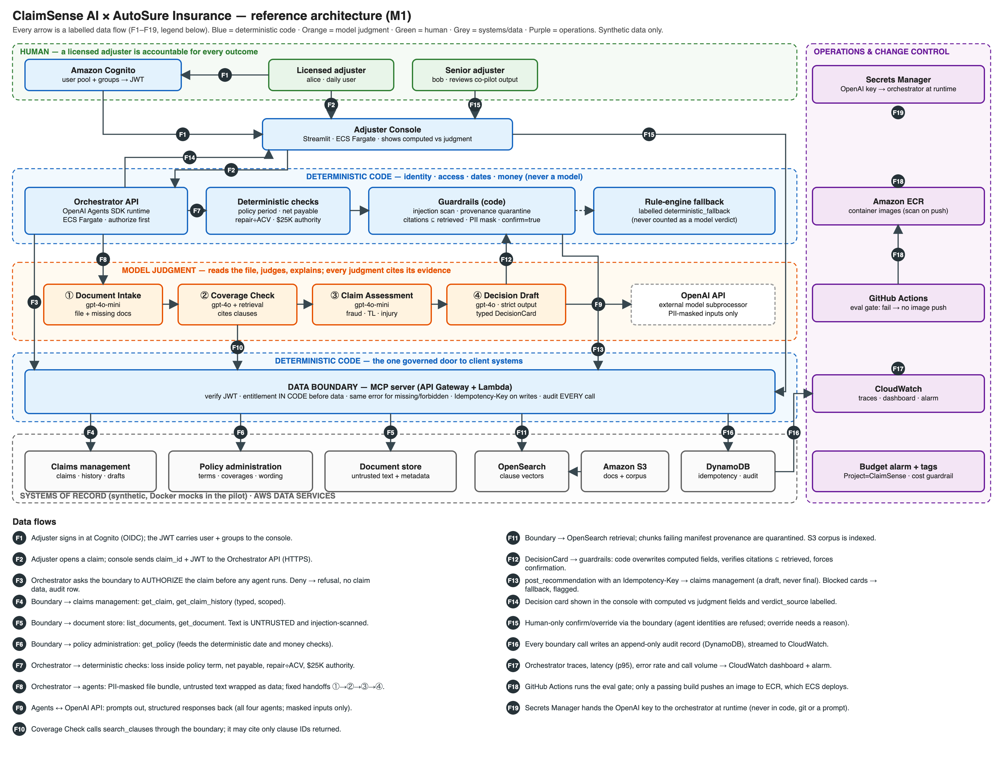

# M1 Deliverable 2: Solution architecture

**Engagement:** ClaimSense AI · AutoSure Insurance (motor) · **FDE:** Susan Wellington · **Date:** 2026-11-05

*Source: [`architecture.svg`](architecture.svg), generated by [`draw_architecture.py`](draw_architecture.py).
Every arrow is a labelled data flow (F1–F19). Blue bands are deterministic code; orange is model judgment.*

## 1. Solutions first: one building block per problem

| Problem (from M0 discovery) | Building block | Where it lives |
|---|---|---|
| The adjuster is the integration layer across three systems | **One data boundary** (MCP server) with typed tools for all three systems | API Gateway + Lambda |
| Coverage turns on clause wording, not a status field | **Coverage Check agent** with **cited retrieval** over a clause corpus | gpt-4o + OpenSearch |
| Fraud is a narrative inconsistency, not a score | **Claim Assessment agent** reads the whole file | gpt-4o-mini |
| Status fields are stale; money must be exact | **Deterministic checks** for policy period, net payable, repair÷ACV and authority limit | Orchestrator (code) |
| Reasoning lives in inboxes | **Decision Draft agent** returns a typed `DecisionCard` with citations | gpt-4o, strict structured output |
| Users must only see what they're entitled to | **Entitlement in code** before any agent; Cognito groups | Data boundary |
| Documents are attacker-influenceable | **Guardrails in code**: injection scan, provenance quarantine, citation check | Orchestrator + boundary |
| A licensed adjuster is accountable | **Human-only confirmation** write; agents are refused | Boundary + console |
| "Prove it before it ships" | **Eval gate** in CI blocks the image push | GitHub Actions → ECR |

## 2. Five layers

1. **Systems of record:** claims management, policy administration (with clause wording) and
   the document store. Untouched; synthetic Docker mocks in the pilot (CISO memo: synthetic only).
2. **Governed access:** the data boundary. JWT verification, entitlement, anti-enumeration,
   idempotency and audit. The **only** path from any agent to any system.
3. **Agents:** four agents with fixed handoffs (Intake → Coverage → Assessment → Decision Draft).
   They reason; they never touch a system directly.
4. **Grounding and proof:** cited retrieval (OpenSearch over the S3 clause corpus, provenance
   manifest), guardrails, and the eval gate in CI.
5. **Human in the loop:** the adjuster confirms or overrides every outcome. That's a gate the model
   can't open (a separate human-only write), not a sentence in a prompt.

## 3. The code/model boundary, explicitly

| Deterministic code (exact, testable, never a model) | Model judgment (always cited) | Human (licensed adjuster) |
|---|---|---|
| Identity: Cognito JWT verified at the boundary | Does the clause **wording** cover this loss and use? | Confirms or overrides **every** outcome |
| Entitlement: group → claim scope, checked **before any agent** | Is the narrative **consistent** across documents? (fraud) | Owns `flag_review` and > $25K approvals (senior) |
| Policy period: loss date/time vs term (`status_field` ignored) | Injury exposure; missing evidence | Override reason becomes a new eval case |
| Money: net payable = gross − deductible; limits | Which evidence supports the draft | |
| Total-loss ratio repair ÷ ACV; $25K authority flag | The written reasoning an auditor can check | |
| Idempotency, audit, PII masking, injection scan, provenance | | |
| Citation check: cited IDs ⊆ IDs actually retrieved | | |

**Telling them apart in every response** (brief acceptance criterion #3): the `DecisionCard` keeps
`computed` (code) and `judgment` (model) in separate typed sections, and carries
`verdict_source: model | deterministic_fallback`. Code **overwrites** the computed section after the
model returns (F12), so the model can't change a date or a dollar figure. A verdict produced by
the rule-engine fallback is labelled and is never scored as a model decision (SC-1).

**Every guardrail, executable:** see [`guardrails.md`](guardrails.md): 7 content guardrails
(reference implementation + 16 tests graded by the M0 scorer), 7 access guardrails (17 contract tests), and data,
release and live cloud guardrails.

## 4. Data flows, trust boundaries and the control at each

Every arrow that crosses a band is a trust boundary, and every trust boundary maps to a
security-questionnaire item (see [`../security-questionnaire.md`](../security-questionnaire.md)).

| Flow | From → to | Data | Boundary crossed | Control | Questionnaire |
|---|---|---|---|---|---|
| F1 | Adjuster → Cognito → console | credentials → JWT (user, groups) | user → identity | managed IdP, MFA, short-lived tokens | #4, #6 |
| F2 | Console → orchestrator | claim_id + JWT | browser → service | HTTPS, JWT required | #6, #7 |
| F3 | Orchestrator → boundary | authorize(claim) | service → access layer | **entitlement in code before any agent**; deny = refusal + audit | #4, #5 |
| F4–F6 | Boundary → 3 systems | typed reads | access layer → systems of record | least-privilege service role, typed contracts, retries with backoff | #2, #5 |
| F7 | Orchestrator → checks | dates, amounts | — (in-process code) | deterministic, unit-tested | #10 |
| F8 | Orchestrator → agents | masked file bundle | code → model | PII masking, untrusted text wrapped as data | #2, #9 |
| F9 | Agents ↔ OpenAI API | masked prompts / structured output | **AWS → external subprocessor** | zero-data-retention terms, no training use, masked inputs | #1, #14 |
| F10–F11 | Coverage Check → boundary → OpenSearch | query → clause hits | model → access layer | cite only retrieved IDs; provenance quarantine | #9, #10 |
| F12 | Decision Draft → guardrails | DecisionCard | model → code | schema-strict output, computed overwrite, citation check | #10, #11 |
| F13 | Orchestrator → boundary → claims mgmt | draft recommendation | code → system of record | Idempotency-Key, draft-only status | #8, #11 |
| F14 | Orchestrator → console | decision card | service → user | computed vs judgment labelled | #11 |
| F15 | Adjuster → boundary → claims mgmt | confirm / override | user → system of record | **human-only**; override needs reason; > $25K needs senior | #11 |
| F16 | Boundary → DynamoDB → CloudWatch | audit records | → audit store | append-only (no update/delete IAM), every call incl. denials | #8 |
| F17 | Orchestrator → CloudWatch | traces, metrics | → ops | PII-masked traces; dashboard + alarm | #8, #13 |
| F18 | GitHub Actions → ECR → ECS | container image | CI → runtime | eval gate must pass; image scan on push | #12 |
| F19 | Secrets Manager → orchestrator | OpenAI key | vault → runtime | never in git, code or prompt; rotation | #6 |

## 5. AWS deployment view

| Component | AWS service | Provisioned |
|---|---|---|
| Document + clause-corpus storage | **S3** (encrypted, versioned, public access blocked) | **M1: now** |
| Container registry | **ECR** (scan on push, immutable tags) | **M1: now** |
| Identity + groups (adjuster, senior-adjuster, fraud-investigator, total-loss-appraiser, customer-service) | **Cognito** user pool | **M1: now** |
| Audit log + idempotency keys | **DynamoDB** (on-demand, PITR) | **M1: now** |
| Logs, dashboard, alarm | **CloudWatch** log groups (retention set) | **M1: now** (dashboard + alarm M4) |
| OpenAI API key | **Secrets Manager** | **M1: now** (placeholder value; real key added by Susan) |
| Cost guardrail | **AWS Budgets** monthly alarm + `Project=ClaimSense` tags | **M1: now** |
| Orchestrator + console | **ECS Fargate** | M2 (when there's an image to run) |
| Data boundary | **API Gateway + Lambda** | M3 |
| Clause vector index | **OpenSearch** (Serverless or a t3.small domain) | M2 (cost-heavy, so only once retrieval is built) |
| CI → registry | **GitHub Actions OIDC** role (no long-lived keys) | M2 |

Provisioning is scripted and idempotent, with teardown: see [`../7-cloud/`](../7-cloud/).

## 6. Agent pattern: a fixed sequence, not a free-roaming agent

The Week 14 agentic-design-patterns masterclass gives the criteria: move to multi-agent when the problem divides into distinct domains **and** those domains need different security boundaries; prefer a planned sequence (ReWOO-style) when the workflow is predictable and tool-heavy; reserve free ReAct loops for dynamic tasks.

ClaimSense's first pass meets all three conditions, so the **orchestrator fixes the plan in code**:
Intake → Coverage → Assessment → Decision Draft, with explicit handoffs. Each agent uses a small,
scoped toolset; only Coverage Check may call `search_clauses`, and no agent can write. The
result: bounded cost and latency (SC-2), no agent choosing its own path to data, and a trace
that's the same shape for every claim, which makes incidents debuggable. *(DECISIONS D-011.)*

## 7. Stack choice: scored, with the condition that flips it

Run [`../tools/stack_matrix.py`](../tools/stack_matrix.py) (output in [`../tools/output/stack-matrix-results.txt`](../tools/output/stack-matrix-results.txt)):

| Stack | Weighted score |
|---|---|
| **OpenAI Agents SDK + OpenAI API, hosted on AWS** (chosen) | **4.65** |
| OpenAI Agents SDK + Claude on Amazon Bedrock, all in AWS | 4.20 |
| OpenAI Agents SDK + Azure OpenAI / Foundry | 3.55 |
| Google ADK + Gemini on GCP | 2.80 |

Weights: brief standard 0.25 · client platform 0.20 · typed output 0.15 · data-path control 0.15 ·
identity 0.10 · ecosystem 0.10 · cost 0.05.

**When it flips:**
- If AutoSure Security **forbids an external model provider** (claim text must stay in the AWS account), Bedrock wins (4.55).
- If AutoSure is an **M365/Entra shop on Azure**, Azure wins (4.15).

The harness (Agents SDK, boundary, eval gate) carries over unchanged; only the model provider changes. *(DECISIONS D-009.)*

## 8. Integration topology

Run [`../tools/topology.py`](../tools/topology.py). The pilot has 3 systems, synchronous
request/reply and a 5-week ship, so the selector picks **point-to-point, funnelled through the one data boundary** (score 5 vs 1 vs 1). At expansion (8 systems, event-driven FNOL, central
governance) it picks a **managed hub** (iPaaS 5, event mesh 4).

**Revisit trigger:** a 5th system, or FNOL events pushed from claims management. *(DECISIONS D-010.)*

## 9. What breaks first at scale, and the design answer

| Breaks first | Why | Design answer |
|---|---|---|
| The legacy systems of record | Rate limits and outages we don't control | Retries with backoff only on `rate_limited`/`upstream_unavailable`, idempotent writes, read caching per claim, agreed rate limits |
| The data boundary | Every call funnels through it (throughput chokepoint, single point of failure) | Stateless Lambda (scales out), DynamoDB on-demand, per-user concurrency limits |
| OpenAI API cost and latency | Four model calls per claim; 150-case CI runs | Small model by default, large model only on Coverage/Decision; mock brain in CI except the gate run; token budget alarm |
| The retrieval index | Re-indexing shifts chunk IDs and breaks citations | Clause IDs are stable keys (not chunk positions); manifest version pinned per run |
