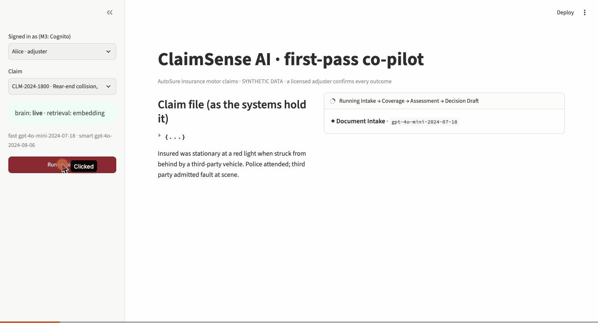
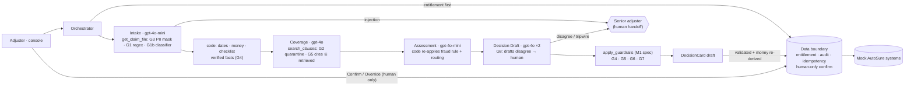

# M2: Building production agents (course Week 15)

> **Naming:** the ClaimSense brief calls this **"Milestone 3 (Week 3)"**. This repo numbers milestones by course
> week: M0 = W13, M1 = W14, **M2 = W15**, M3 = W16, M4 = W17.

Goal: move from architecture to a **working claims pipeline**. Four agents on the OpenAI Agents SDK, grounded in
retrieved policy clauses, running in containers from one command, under change control. A CI eval gate blocks
the image push, and model verdicts are always distinguishable from the deterministic fallback.



## Deliverables: the union of every source

Sources: the W15 assignment page (5 deliverables), the brief's Milestone 3, and the W15 class (M2 floor: a
guardrail that trips, human handoff, CI gate green, traces; stretch: Strands, Lambda/AgentCore, cost table).

| # | Deliverable | Required by | Where | Proof |
|---|---|---|---|---|
| 1 | **Agent set on the OpenAI Agents SDK with strict typed outputs** | assignment · brief M3 | [`claimsense/agents_def.py`](claimsense/agents_def.py) · [`models.py`](claimsense/models.py) · [`pipeline.py`](claimsense/pipeline.py) | Four agents (Document Intake, Coverage Check, Claim Assessment, Decision Draft), each with a strict Pydantic `output_type`; every card validates against the M1 DecisionCard schema ([`tests/test_contract_and_types.py`](tests/test_contract_and_types.py)) |
| 2 | **Containers; the stack starts with one command** | assignment · brief M3 | [`docker-compose.yml`](docker-compose.yml) · [`services/`](services/) · [`Makefile`](Makefile) | `make up` starts 4 services (mock systems, boundary, orchestrator, console); [`evidence/stack-smoke.txt`](evidence/stack-smoke.txt); CI job `stack-smoke` does the same on every push |
| 3 | **Retrieval over the policy corpus; coverage cites the clause IDs actually retrieved** | assignment · brief M3 | [`claimsense/retrieval.py`](claimsense/retrieval.py) · [`tools.py`](claimsense/tools.py) · [`guardrails.py`](claimsense/guardrails.py) | Coverage and Decision tripwires reject any clause not retrieved for *this* request; quotes are the retrieved wording, never a paraphrase ([`tests/test_guardrails_tripwires.py`](tests/test_guardrails_tripwires.py), [`tests/test_retrieval.py`](tests/test_retrieval.py)) |
| 4 | **CI pipeline in which a failing eval gate blocks the image push** | assignment · W15 class | [`../.github/workflows/eval-gate.yml`](../.github/workflows/eval-gate.yml) · [`cloud/oidc.sh`](cloud/oidc.sh) | `build-push` needs every gate (replay gate on each PR, live-model gate on main); GitHub OIDC role scoped to one ECR repo; red-gate and green-gate runs in [`evidence/`](evidence/) |
| 5 | **All four decision outcomes correct; model verdicts distinguishable from fallback** | assignment · brief M3 | [`claimsense/deterministic.py`](claimsense/deterministic.py) · `verdict_source` + `decided_by` | **Live: 40/40 in each of 3 runs, same answer every time** ([`evidence/results-live-stability.txt`](evidence/results-live-stability.txt)); fallback is labelled, never approves, never counts for the gate ([`tests/test_deterministic.py`](tests/test_deterministic.py), [`tests/test_eval_gate.py`](tests/test_eval_gate.py)) |
| W15 | A guardrail that **trips** + **human handoff** | class M2 floor | `@input_guardrail` + 3 `@output_guardrail` tripwires | CS-016 / CS-035 stop at Intake and go to a senior adjuster; console shows the handoff |
| W15 | **Traces** and **restart-survivable sessions** | class M2 floor | [`claimsense/observability.py`](claimsense/observability.py) · [`evals/restart_survival.py`](evals/restart_survival.py) | Every run writes a JSONL trace (agent, generation, tool, guardrail spans); OpenAI Traces when live. **State survives restarts** (D-027): per-step checkpoints on the `/state` volume, so `POST /recommend` with the same `run_id` resumes without re-running or re-paying; the boundary persists drafts, idempotency and audit. CI kills the orchestrator mid-claim and restarts the boundary twice on every push ([`evidence/restart-survival.txt`](evidence/restart-survival.txt)) |
| W15 | **Model routing + cost table** | class | [`evidence/cost-table-live.md`](evidence/cost-table-live.md) | Pinned gpt-4o-mini-2024-07-18 for the volume steps, gpt-4o-2024-08-06 for the money steps: **$0.019 per claim** (incl. second opinion and G1b), p95 19 s |

### Added Features / Extra Credit
- **Measured stability + release gate** (D-025): 3 live runs, 40/40 each, **40/40 cases gave the same answer
  every run**. `make release` blocks unless every case is right ≥ 2/3 and every adversarial case 3/3. It
  caught a real bug on its first try (below).
- **Second-opinion Decision Draft (G8)**: every live claim is drafted twice; if the drafts disagree, a senior
  adjuster decides instead of a coin flip going out. 0 disagreements in 120 live claim runs.
- **Pinned model snapshots** (D-025): a score change can only come from our prompts, never a silent upgrade.
- **Adversarial guardrail fuzz suite as a CI gate** (D-026, [`evidence/guardrail-fuzz.txt`](evidence/guardrail-fuzz.txt)):
  15 mutation families (zero-width characters, Cyrillic look-alikes, full-width, leetspeak, base64, five
  languages, …). It found that G1 caught 17% and G3 masked 79%; both were hardened to 99.9% and 100%, with
  zero false positives on 155 benign texts.
- **G1b injection classifier** (D-026): on held-out attacks written before each test and never tuned on,
  regexes alone caught 1/15; **G1 + G1b caught 13/15 with 0/15 false positives**. It can only escalate to a
  human, fails closed, and CI replays cached verdicts at $0.
- **Restart-survivable state, proven on every push** (D-027): kill the orchestrator mid-claim and the run
  resumes from its checkpoints; restart the boundary and drafts, idempotency, confirmations and the audit
  trail are intact; a draft is decided exactly once.
- **Boundary hardening** (D-024): agents can't confirm even when acting for a human; drafts are validated
  and their money re-derived at the door; malformed bodies get a 400.
- **OWASP Top 10 for LLM Apps (2025) mapping** ([`SECURITY.md`](SECURITY.md)): every risk → control → test → residual.
- **Supply-chain gate**: CI scans the exact image it would push (Trivy, pinned) and publishes a CycloneDX
  SBOM; a fixable HIGH/CRITICAL CVE blocks the push. OS patches are applied at build (the first scan found 2 HIGH).
- **Operations runbook** ([`RUNBOOK.md`](RUNBOOK.md)): signals, outage/hold-spike/rollback/key-rotation
  procedures, release checklist.
- **HTML eval report** ([`evidence/eval-report.html`](evidence/eval-report.html), `make report`): every case × every run.
- **20 new eval cases** (CS-021 to CS-040, [`evals/cases-m2.json`](evals/cases-m2.json)): 40 of the 150 due by Week 5. They add two adversarial families, **PII exposure** (the M1 "still to come" item) and **citation forgery**, plus exact boundaries ($25,000 vs $25,001; ratio 1.0; first and last day of term).
- **Strands port** of the Coverage agent ([`stretch/strands_coverage.py`](stretch/strands_coverage.py)): same prompt, typed output, retrieval and citation rule on a second harness ([`evidence/strands-port.json`](evidence/strands-port.json)). The first attempt let the model skip the tool, and the same G5 check caught every invented clause ID ([`evidence/strands-port-attempt1-structured_output-only.json`](evidence/strands-port-attempt1-structured_output-only.json)).
- **Deploy ladder**: the pushed image runs unchanged on AWS Lambda (Web Adapter), IAM-signed invoke, then torn down ([`cloud/lambda/`](cloud/lambda/)). AgentCore Runtime is the managed next rung.
- **Adjuster console** (Streamlit): watch the four agents stream; badge for Model verdict / Guardrail hold / Deterministic fallback / Refused; code-computed facts shown apart from model judgment; human-only Confirm / Override.
- **Secrets at runtime**: the OpenAI key is read from Secrets Manager in AWS, never baked in (D-023).
- [`DECISIONS.md`](DECISIONS.md): D-017 to D-027.

## Headline numbers (live, 3 runs × 40 cases, pinned gpt-4o-mini-2024-07-18 + gpt-4o-2024-08-06, prompt m2-v8)

| | Result (each of 3 runs) | Target |
|---|---|---|
| Decision accuracy | clear 15/15 · edge 14/14 · **overall 40/40 · 40/40 · 40/40** | ≥ 90% · ≥ 75% · gate ≥ 85% |
| **Stability** | **40/40 cases gave the same answer in every run**; 0/120 second-opinion disagreements | release gate: every case ≥ 2/3 |
| Adversarial | **11/11** every run | 100% (gate) |
| Verdicts model-produced | 40/40 (fallback share 0%) | 100% (gate) |
| Fraud routing | recall 4/4 · false routes 0/34 | ≥ 90% · ≤ 10% |
| Confirmable as written (correct + every required citation) | 24–25/27 (89–93%) | M0 SC-3 proxy |
| Latency per claim | p95 17–19 s · median 15–16 s | < 90 s |
| Cost per claim | $0.019 (≈ $185/month at 450 claims/day) | |
| Injection detection, never-seen attacks (held-out v3) | G1 alone 1/15 → **G1 + G1b 13/15**, 0/15 false positives | M3: 100+ red-team set |

**How we got there.** The first live run was **blocked** (35/40, one adversarial miss). Every miss was traced to
a root cause, and almost every fix moved a *rule* out of the model and into code (D-001): the required-document
checklist, routing priority, the fraud rule, renewal-pending and theft-reporting conditions, and plain statements
of what code has already verified. Golden labels were never changed. The full history of runs is in
[`evidence/results-live-*.txt`](evidence/).

**Stability is measured, not assumed.** On the final prompts and pinned snapshots, three independent live
runs gave the same correct answer for all 40 cases, and the two independent Decision drafts never disagreed
(0 of 120 claim runs). The 85% deploy floor is the M0 charter's accuracy target. The release gate is
stricter (every case ≥ 2/3, adversarial 3/3), and any claim where the model *is* unsure goes to a senior
adjuster rather than out as a confident verdict (G8).

## Evidence (`evidence/`)

| File | Shows |
|---|---|
| [`results-live-stability.txt`](evidence/results-live-stability.txt) · `results-live-run1…3.txt` | **Release gate PASS**: 3 live runs, 40/40 each, every case stable |
| [`eval-report.html`](evidence/eval-report.html) | The same, as one page: every case × every run, fuzz results, cost |
| [`cost-table-live.md`](evidence/cost-table-live.md) | Per-agent tokens and cost (incl. second opinion and G1b) |
| [`guardrail-fuzz.txt`](evidence/guardrail-fuzz.txt) | Fuzz gate: 99.9% / 100% on mutated attacks and PII, 0 false positives; held-out sets reported separately |
| [`results-live-final.txt`](evidence/results-live-final.txt) | The first single-run 40/40 (before pinning and G8) |
| `results-live-v1…v7*.txt` | Every live run while tuning, including the blocked ones (nothing hidden) |
| [`ci-red-gate-push-skipped.jpg`](evidence/ci-red-gate-push-skipped.jpg) | Branch `demo/red-gate` disables the injection scan: tests and gate fail, **live-eval and build-push skipped** (run [#9](https://github.com/cinnamon0590/FDE-ClaimSense-Capstone/actions/runs/42323422068)) |
| [`ci-green-gate-image-pushed.jpg`](evidence/ci-green-gate-image-pushed.jpg) | Every gate green incl. the live model, then build-push to ECR via OIDC (run [#11](https://github.com/cinnamon0590/FDE-ClaimSense-Capstone/actions/runs/42324129359)) |
| [`stack-smoke.txt`](evidence/stack-smoke.txt) | One claim per outcome through the 4 running containers; agent refused at confirm; human confirms; denials audited |
| [`console-live-approve.jpg`](evidence/console-live-approve.jpg) · [`console-injection-guardrail-hold.jpg`](evidence/console-injection-guardrail-hold.jpg) | Live model verdict badge; CS-016 stopped at Intake and handed to a senior adjuster |
| [`console-demo.gif`](evidence/console-demo.gif) | Live console on the pinned models: model verdict APPROVE ($0.021), then CS-016's injected invoice held at Intake ($0.0003) |
| [`restart-survival.txt`](evidence/restart-survival.txt) | Orchestrator killed mid-claim → restarted by Docker → run resumed (Intake and Coverage restored, not re-billed); boundary restarted twice with no duplicate draft, confirmation replayed, second decision refused, audit intact |
| [`lambda-invoke.txt`](evidence/lambda-invoke.txt) | The CI-pushed image on Lambda: approve, guardrail hold, authority flag, refusal; then torn down and verified gone |
| [`strands-port.json`](evidence/strands-port.json) | Coverage agent on Strands: cites only retrieved clauses; planted chunk quarantined |

## How it works



```
adjuster ─► console ─► orchestrator ─► boundary (entitlement · audit · idempotency) ─► mock AutoSure systems
                          │
                          ├─ Intake (mini) ── get_claim_file: PII masked, injected text removed (G1/G3/G7)
                          ├─ code: dates, money, checklist, verified facts, coverage questions
                          ├─ Coverage (4o) ── search_clauses: provenance quarantine (G2); cites ⊆ retrieved (G5)
                          ├─ Assessment (mini) ── code re-applies fraud rule + routing priority
                          ├─ Decision Draft (4o) ── tripwire: citations, other claims, echoed injections
                          └─ apply_guardrails (M1 spec, unchanged) ─► DecisionCard ─► draft written back
```

The M1 reference modules (guardrails, boundary, scorer) are **imported, not copied**
([`claimsense/_m1.py`](claimsense/_m1.py)), so the spec and the product can't drift apart.

**Brains.** `live` calls OpenAI. `replay` plays back recorded model turns through the real Runner, tools,
parsing and guardrails: $0, deterministic, no key. That is what CI runs on every PR. Replays are re-recorded
whenever a prompt changes (`make record`); 38 of 40 are real recordings. The two injection cases stop at Intake
by design, so a full recording never exists for them.

## Run it

```bash
colima start                      # Docker runtime (once per boot)
cd M2 && make up                  # console: http://localhost:8510 (8501 is taken on this laptop)
make smoke                        # one claim per outcome through the running stack
make test                         # 51 tests incl. the guardrail fuzz gate and restart survival, $0
make restart-test                 # kill/restart the running containers and prove nothing is lost ($0)
make evals                        # the CI gate on the replay brain, $0
make evals-live                   # the gate on the live models (needs OPENAI_API_KEY in M2/.env, ~$0.80)
make release                      # RELEASE gate: 3 live runs, stability per case (~$2.70, by hand before a release)
make fuzz                         # adversarial guardrail fuzz ($0)
make report                       # evidence/eval-report.html from the committed results
```

No key? Leave `OPENAI_API_KEY` empty (or `MOCK_BRAIN=1`) and everything runs on the replay brain.

## Found and fixed along the way
- **M1 guardrail spec echoed injected text** into the card when routing to a human. It now reports a count (D-020).
- **M0 scorer made the gate demand 100% accuracy.** "Every verdict model-produced" also counted correctness. It is now one shared `gate_passes()` with a test (`test_gate_allows_a_few_misses_above_the_floor`).
- **Recorder** could overwrite good replays during an outage (found when the OpenAI credit ran out mid-run). Recordings are now staged and committed only for complete claims, with a regression test.
- **Deploy script** first passed the key as a Lambda env var; replaced with a runtime Secrets Manager read before any deploy (D-023).
- **Boundary trusted its callers too much** (pre-review guardrail audit). Three problems, all fixed with
  regression tests in [`tests/test_boundary_hardening.py`](tests/test_boundary_hardening.py) (D-024):
  - An agent acting for a human could confirm a draft.
  - A forged draft's own `net_payable` was used for the $25K authority check.
  - A malformed body crashed the route (500) instead of returning 400.
- **Guardrail mutation audit:** each of G1–G7 was switched off in turn.
  - G1, G2, G3 and G6 turn the eval gate red.
  - G5 and G7 are caught by the tripwire tests instead. The recorded models never cite an unretrieved
    clause or leak another claim, partly because G7's input-side mask hides other claim IDs from the model.
  - G4 is structural: the Decision agent's typed output has no `computed` field, so the model can't
    supply a number.
  - Both the gate and the tests block the image push.
- **The release gate caught a real bug on its first run.** Back-to-back runs in one process started a new
  event loop each time, while the OpenAI client kept connections bound to the old, closed one. The first
  claims of runs 2 and 3 fell back ("Event loop is closed"), and the gate went BLOCKED. Fixed with one loop
  per process (`run_sync`), plus a regression test. Production was never affected: the orchestrator runs one
  long-lived loop.
- **Recorder writes are atomic** (temp file + rename), so a reader never sees a half-written replay or cache.
- **Resume used paraphrased quotes, and the M1 boundary allowed a second confirm** (found building D-027).
  Checkpoints stored retrieved clause IDs but not their text, so a resumed card showed the model's wording.
  Separately, a draft could be confirmed again under a new idempotency key. Both fixed, with tests.
