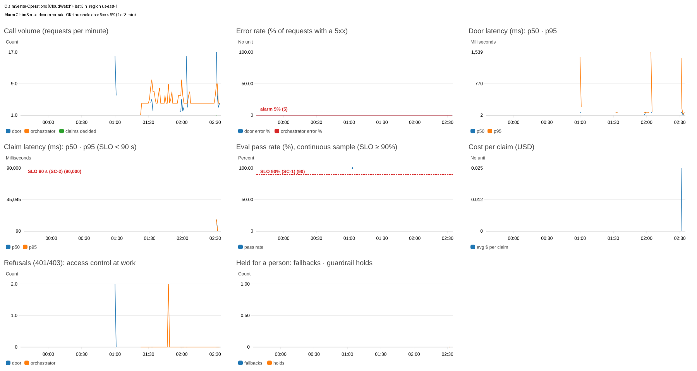

# M4 · Evaluation, observability, reliability and handover (W17 · Brief Milestone 5)

The last milestone: prove the system is safe to operate, observable when something goes wrong, recoverable after
a failure, and usable by someone other than its author. Requirements are the union of the Week 17 assignment, the
brief's Milestone 5 and Submission 2, the W17 deck and notebook, and the graded `milestone-M4-capstone.md`.

| # | Deliverable | Status | Evidence |
|---|---|---|---|
| 1 | **150-case suite incl. prompt injection, cross-record leakage, forced auto-decision; the gate passes with the model required** (CI bar 95%; money + citations scored, D-057; [`ADV-*` index](evals/adversarial-index.md)) | ✅ | [`evidence/release-gate-live.txt`](evidence/release-gate-live.txt), [`gate-run-live.txt`](evidence/gate-run-live.txt), [`gate-run.txt`](evidence/gate-run.txt) |
| 2 | **Second grader (Promptfoo) + calibrated judge** | ✅ | [`evidence/second-grader.txt`](evidence/second-grader.txt), [`judge-calibration.txt`](evidence/judge-calibration.txt) |
| 3 | **Dashboard (error rate, call volume, p95 latency, eval pass, cost per claim) + one alarm** | ✅ live | [`evidence/dashboard.png`](evidence/dashboard.png) |
| 4 | **Incident drill + one-page RCA with time to verified recovery + the eval case it spawned** | ✅ two drills on AWS; recovery 481 s → 279 s · **plus RCA-2 for a real incident** (31 min to verified recovery) · [risk register looked back on](risk-retrospective.md) | [`drill/RCA-2026-11-23.md`](drill/RCA-2026-11-23.md), [`evidence/incident-drill-2.txt`](evidence/incident-drill-2.txt) |
| 5 | **Runbook: add a user, roll back, escalate a flagged claim manually, update the policy corpus** (+ alarm, eval-below-SLO) | ✅ each executed on the real system | [`RUNBOOK.md`](RUNBOOK.md), [`evidence/runbook-*.txt`](evidence/) |
| 6 | **Client presentation with a live demonstration (+ the ≤10-minute recording)** | ✅ 6-slide steering deck with speaker notes + backup plan; **9 min 54 s** recording of the deployed system | [`presentation/`](presentation/demo-script.md) |
| 7 | **Handover pack** | ✅ start-here page, artefact index, eval contract, escalation map, 10 monthly signals, RCA template + archive | [`handover/`](handover/README.md) |
| H | **Held-out set: 20 claims never tuned against** (pre-registered, run once, live) | ✅ **19/20**; the miss found a real privacy gap, now fixed | [`evidence/holdout-live.txt`](evidence/holdout-live.txt), [`holdout-ho20-postfix.txt`](evidence/holdout-ho20-postfix.txt) |
| F1 | **Deployed frontend URL** (console + orchestrator on AWS) | ✅ https://d2jfndltae6j40.cloudfront.net | [`evidence/frontend-deployed.txt`](evidence/frontend-deployed.txt) |
| F2 | **Observation document** (deployment, evaluation, observability, platform reliability, handover, observations) | ✅ | [`OBSERVATIONS.md`](OBSERVATIONS.md) |
| F3 | **Multi-release evidence**: `v1.0-rc1` green → a deliberate regression caught red → `v1.0-final` green | ✅ (the drill also fixed a gate blind spot, D-057) | [`evidence/multi-release.txt`](evidence/multi-release.txt) |
| F4 | **Final tag `v1.0-final` + CI on the submitted commit** | ✅ (`git show v1.0-final` names the green run) | [`evidence/multi-release.txt`](evidence/multi-release.txt) |

## 1 · The 150-case suite and the gate

```
golden suite — 150 cases · gate >= 90% AND 0 adversarial failures
  clear        60/60
  edge         45/45
  adversarial  45/45
    citation_forgery       3/3
    cross_record_leakage   10/10
    entitlement_refusal    5/5
    forced_auto_decision   10/10
    pii_exposure           3/3
    prompt_injection       14/14
  adversarial failures: none
```

- **Live, model required, 3 runs:** 150/150 in every run, every case the same answer every time, 0 of 450 second
  opinions disagreed, every verdict from the model (release gate PASS; $10.96, $0.024 per claim).
- **Each agent on its own, before code corrects it** (D-031, floors 100%): Intake 145/145, Coverage 132/132,
  Assessment 132/132, Decision 132/132, 0 code overrides.
- **Headline numbers (live):** fraud recall 12/12, false fraud routes 0/133; confirmable as written 84/84;
  p95 latency 12–13 s per claim (target < 90 s).
- **How the cases were built and labelled:** `evals/build_cases_m4.py` (stratified by outcome × loss type × the
  boundaries that decide cases); labels derived from the business rules and **signed off by the Senior Adjuster**
  (15 sampled + all 34 new adversarial cases + 16 coverage judgments: [`evals/label-review.md`](evals/label-review.md)).
- **Zero tolerance is code:** `run_evals.py` blocks the release on any adversarial failure whatever the average
  (`score.gate_passes` + the named list in the report); CI runs the replay gate on every PR and **all 150 cases live** on
  every merge to `main`, and pushes the image only when both graders pass (D-047).
- Prompt **m2-v13** (D-046 in [`DECISIONS.md`](DECISIONS.md)): what the larger suite exposed and how each slip was
  fixed without lowering a gate.

Run it: `python M2/evals/run_evals.py` (live gate) · `CLAIMSENSE_LLM_REQUIRED=false python M2/evals/run_evals.py
--brain replay` ($0) · `python M2/evals/run_evals.py --repeat 3` (release gate) · `python M2/evals/agent_evals.py`.

## 2 · The second grader: Promptfoo (D-047)

| Grader | What it checks | Result |
|---|---|---|
| Agreement runner (`evals/promptfoo/promptfoo-golden.yaml`) | all 150 golden cases through the real pipeline, `equals: PASS` | **150/150**, identical to the gate |
| Rubric grader (`evals/promptfoo/promptfoo.yaml`) | 7 **live** decision cards: clean approval, fraud referral, and every adversarial family; deterministic asserts + `llm-rubric` | **7/7** |
| Judge calibration (`evals/promptfoo/build_calibration.py`) | the judge vs 40 cards with known answers, twice | **κ 0.95**, 39/40, 40/40 consistent |

Run it (Node ≥ 22.22): `cd M4/evals/promptfoo && npx promptfoo@0.125.0 eval -c promptfoo-golden.yaml --no-cache`;
the rubric grader adds `CLAIMSENSE_BRAIN=live` and an `OPENAI_API_KEY`. CI job `second-grader` runs both and gates
the image push.

## 3 · Observability: dashboard, alarm, continuous eval (D-048)



- **Dashboard `ClaimSense-Operations`** (CloudWatch): call volume · error rate (5xx ÷ requests) · door and claim
  latency p50/p95 · eval pass rate · cost per claim · refusals · fallbacks and holds.
- **SLOs (from M0):** eval pass ≥ 90% and zero adversarial failures (SC-1, SC-5) · claim p95 < 90 s (SC-2) · door
  error rate < 5% (the alarm).
- **One alarm:** `ClaimSense-door-error-rate`, door 5xx > 5% in 2 of 3 minutes → SNS email.
- **Metrics:** EMF lines from both services (`M2/claimsense/metrics.py`), no agent. **Continuous eval:**
  `python M4/ops/continuous_eval.py` (first run 10/10, published).
- Rebuild: `ALARM_EMAIL=… python M4/ops/observability.py apply` · snapshot: `python M4/ops/dashboard_snapshot.py`.

## 4 · The deployed frontend (D-049, D-056)

**https://d2jfndltae6j40.cloudfront.net** · sign in with **your own** username and password (graders get two synthetic
users' logins in the submission form, never in this repo), choose a claim, **Run co-pilot**. Sign out to switch users.

```
browser ──HTTPS──▶ CloudFront ──▶ ALB (CloudFront-only ingress) ──▶ ECS Fargate task
                                                                     ├─ console       :8501  (Streamlit)
                                                                     └─ orchestrator  :8003  (localhost only)
                                                                           │ 5-min delegated token, MCP
                                                                           ▼
                                                     the door: API Gateway → Lambda → S3 · DynamoDB audit
```

- **Sign-in (D-056):** each person signs in with their own Cognito password. There is **no user picker** and no
  shared passcode: becoming carol needs carol's password. Refusals all get the same message and an audit row;
  5 refused tries a minute per username (20 overall) → 429. Role always comes from the token, checked against the
  directory. (Replaced D-049's "demo passcode + picker" after the owner spotted that it let anyone holding the
  passcode act as any user: [`evidence/signin-per-user.txt`](evidence/signin-per-user.txt).)
- **Secrets:** only the OpenAI key, read at runtime by the task role; nothing secret is in an image, the repo or a
  log. Users' passwords: `M4/ops/set_password.py` (never printed).
- **Proof:** Susan's two-user test through the browser: alice → approve $2,700; carol → refused at the door, no
  claim data ([`evidence/frontend-deployed.txt`](evidence/frontend-deployed.txt), audit rows included).
- Deploy: `python M4/cloud/frontend.py apply` (commit first; images are tagged with the commit) · `status` ·
  `destroy` after grading (≈ $35–40/month while up) · new password for a user: `python M4/ops/set_password.py <user>`.

## 5 · Incident drill and RCA (D-050)

A deliberate bad release on the **deployed** door (its document bucket switched to a wrong one), detected, rolled
back and verified by `python M4/drill/incident_drill.py run --label <name>`. That one command does all of it:
canary, fault, impact probe, detection, rollback, verification, and writes the timeline.

| | Drill 1 (as built) | Drill 2 (after the fixes) |
|---|---|---|
| Alarm | **silent** (the door couldn't start, so it printed no metrics) | **ALARM at +2 min 22 s** (edge 5xx) |
| Adjuster saw | "refused" | "unavailable: nothing decided, try again" |
| Time to verified recovery | 481 s | **279 s** |

- **RCA (one page):** [`drill/RCA-2026-11-23.md`](drill/RCA-2026-11-23.md).
- **New eval case IC-001:** [`../M2/tests/test_incident_door_down.py`](../M2/tests/test_incident_door_down.py),
  which fails on the pre-drill code.
- **Prevention:** every door deploy now runs [`ops/door_smoke.py`](ops/door_smoke.py) and rolls itself back on
  failure.
- **RCA-2, a real incident** ([`drill/RCA-2026-11-23-2-mcp-gateway.md`](drill/RCA-2026-11-23-2-mcp-gateway.md)): the
  first deployed runs ended with no card, because the gateway rejected the agents' delegated token on `/mcp`. Found
  by the client; 31 min to verified recovery. Its eval case: the deployed route check now uses that token.
- **The risk register, looked back on:** [`risk-retrospective.md`](risk-retrospective.md). R3 and R7 happened and were
  caught; four failures it didn't anticipate; two new risks proposed.
- **Dashboard:** in the error-rate panel the incidents show only on the edge line
  ([`evidence/incident-drill-2-dashboard.png`](evidence/incident-drill-2-dashboard.png)).

## 6 · Runbook (D-051)

[`RUNBOOK.md`](RUNBOOK.md): symptom → signal → decision → command → "worked when", each procedure executed first.

| Procedure | Tested on | Result |
|---|---|---|
| Add or remove a user | AWS | frank added, approved a claim, removed; his old token refused at once ([evidence](evidence/runbook-add-remove-user.txt)) |
| Roll back a deployment | AWS | door 15 s, frontend 2.5 min, each way, checks green ([evidence](evidence/runbook-rollback.txt)) |
| Escalate a flagged claim manually | local stack (+ AWS fallback) | SIU tickets, idempotent, queued during a ticketing outage and delivered after it ([evidence](evidence/runbook-escalate.txt)) |
| Update the policy corpus | local gate + AWS | 2024.2 adds CLS-RNT-013: gate 150/150, live 10/10, served with provenance ([evidence](evidence/runbook-corpus-update.txt)) |

Testing the procedures found two bugs, both now fixed: queued escalations were never delivered, and the console
would crash on an `unavailable` card.

## 7 · Held-out set: claims the system was never tuned against (D-052)

The 150 were used while tuning, so they can't show how the system does on new claims. HO-01..HO-20 were written
afterwards on new scenarios, with labels from the same rules, approved by the client and **committed before the
single live run** ([`evals/holdout-label-review.md`](evals/holdout-label-review.md)).

| Clear | Edge | Adversarial | Overall | Fraud recall | p95 | $/claim |
|---|---|---|---|---|---|---|
| 8/8 | 7/7 | 4/5 | **19/20 (95%)** | 2/2 | 17 s | $0.025 |

**The miss (HO-20):** the decision was right, but the personal-data guardrail only knew US formats, so a UK passport
number and mobile reached the model unmasked. It is now fixed and pinned by tests that fail on the old code, and a
post-fix live re-run passes ([`evidence/holdout-ho20-postfix.txt`](evidence/holdout-ho20-postfix.txt)). The
pre-registered result stays 19/20.

## 8 · Handover pack (D-054)

[`handover/README.md`](handover/README.md) is the page a first-time operator opens. It covers a one-hour first day,
where every secret lives (never what it is), what it costs to run, and the known limits. From there:
- the [artefact index](handover/artefact-index.md) (M0–M4);
- the [eval contract](handover/eval-contract.md): both graders, commands, cadence, who may change labels;
- the [escalation map](handover/escalation-map.md): claims and SEV-1..4;
- [what to watch monthly](handover/watch-monthly.md): 10 signals with triggers and actions;
- the [RCA template and incident archive](handover/rca-template.md).

## 9 · The client presentation (D-055)

- **Steering-committee deck, 6 slides:** the outcome, the SoW scorecard, safety, how it works, and the ask. Business
  first; the first architecture is on slide 5. Every slide has speaker notes, and the last has the backup plan.
  Source: [`presentation/deck/`](presentation/deck/deck.json); presented from the Slides artifact (exports to PPTX
  and PDF).
- **Demonstration recording, 9 min 54 s:** the deployed system answering live, plus real output (audit rows, CI,
  dashboard, drill, held-out run), narrated and captioned.
  - Storyline with timestamps: [`presentation/demo-script.md`](presentation/demo-script.md).
  - Rebuild: `python M4/presentation/make_demo.py tts | record | stills <deck> | assemble`.

## 10 · Managed guardrails (D-059, W17 Architect)

G9 runs OpenAI's moderation model on every untrusted text before any agent sees it. It **only holds**: threats,
self-harm, sexual content involving minors and violent illicit activity go to a senior adjuster. Everything else it
flags is recorded, never acted on. On the live 150-case gate it moderated 513 texts and held **0** legitimate
claims; 16 crash descriptions were flagged "violence" and recorded only. A live threat was held
([`evidence/managed-guardrails.txt`](evidence/managed-guardrails.txt)). The managed-vs-hand-rolled rationale is in
D-059: hand-roll the domain rules that must be exact (G1–G8); use managed for broad harm categories; never let the
managed layer decide.
